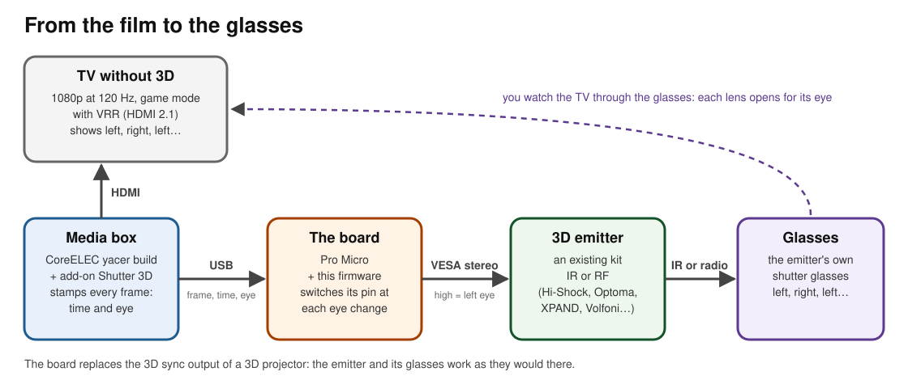
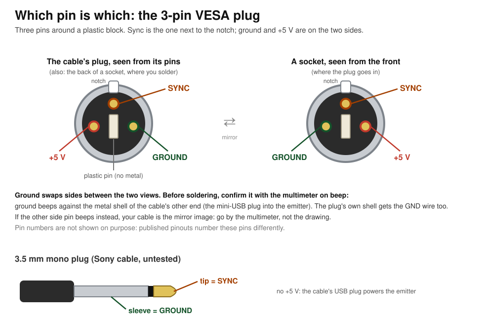
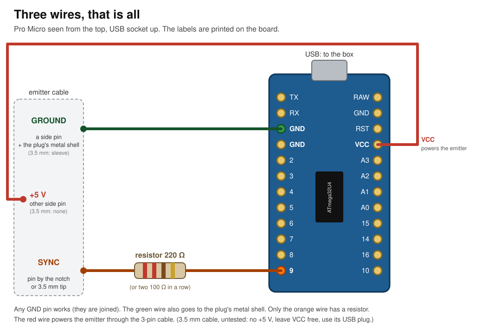
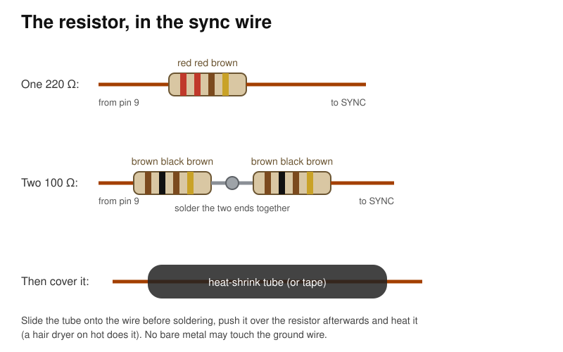
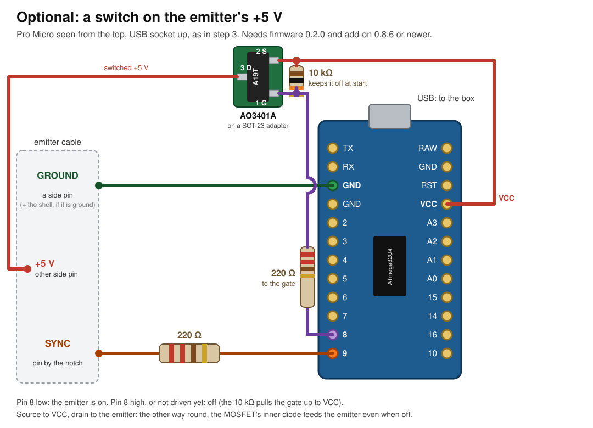
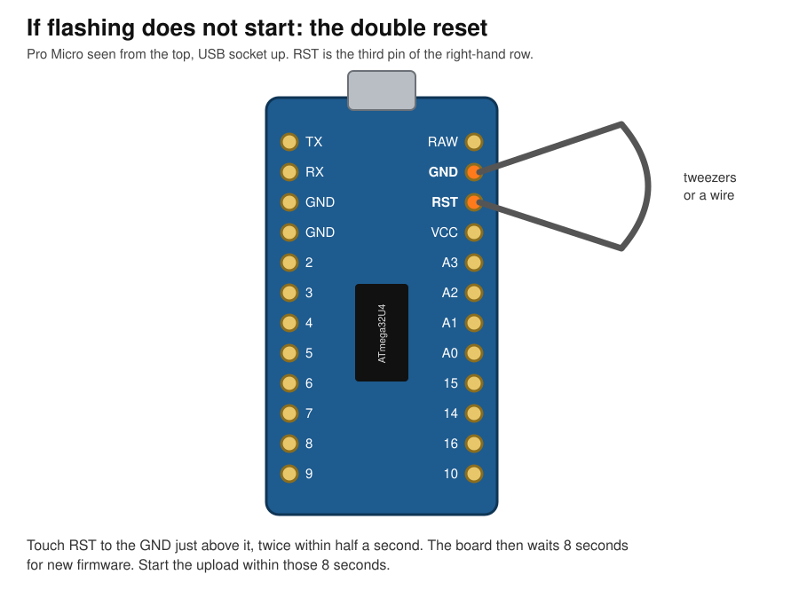

# Building and using the board

## What it does

3D films show each eye a slightly different picture. **3D glasses with
shutters** do this by blacking out one lens, then the other, many times a
second, while the screen shows the left eye's picture, then the right eye's,
in step with them. Your brain merges the two into depth.

A TV without 3D can still show the two pictures one after the other, fast
enough. What is missing is something that tells the glasses *exactly* when
the screen switches eye.

**You do not need new glasses.** 3D projectors and 3D graphics cards drive
glasses through a small box, the **3D emitter**, that comes with the
glasses. The emitter has a standard input, **VESA stereo**: one wire that is
high while the screen shows the left eye and low for the right. The emitter
turns that into infrared or radio for its own glasses.

**This board takes the projector's place.** It plugs into the media box by
USB, learns from it exactly when each picture appears on the screen, and
drives the emitter's VESA input. The emitter and its glasses then work as
they would with a 3D projector.

## How it fits together



**The TV must accept 1080p at 120 Hz with VRR** (variable refresh rate,
HDMI 2.1), in its game mode. Most recent gaming TVs do; it needs no 3D
support.

1. **The box** runs the
   [CoreELEC yacer-patched build](https://github.com/allolive/CoreELEC/tree/yacer).
   Its frame-sequential 3D patch is what makes 3D possible on a 2D TV: when
   you play a 3D film (Blu-ray 3D, side-by-side or top-and-bottom), it sends
   1080p at 120 Hz in the TV's game mode, slowed with VRR to a whole multiple
   of the film's rate (96 Hz for a 24p film), and shows left, right, left,
   right on successive frames. At every frame it notes the exact moment and
   which eye it shows. Plain CoreELEC does none of this and cannot drive the
   board.
2. **The Kodi add-on** [Active 3D for 120 Hz VRR displays](https://github.com/allolive/kodi_addons) (`service.shutter3d.allolive`) finds the board on the
   box's USB ports and forwards each of those notes to it: the frame's
   number, its exact time, and the eye.
3. **The board** (a Pro Micro running this firmware) cannot simply switch
   when a note arrives, because USB delivers each one a little late, by a
   varying amount. Instead it works out the box's clock from the notes,
   predicts the next switch to the microsecond, and switches its output pin
   in hardware at that moment. If the notes stop for a moment, it carries
   on alone for up to 2 seconds.
4. **The emitter** reads that pin through its standard **VESA stereo** input
   (high = left eye) and sends the timing to the glasses by radio. It takes
   its power from the board through the same cable.
5. **The glasses** open and close each lens in step.

## Which emitters and glasses

Any emitter with a **VESA stereo input** can technically drive the glasses,
infrared (IR) or radio (RF): the board only drives the standard signal, and
the emitter speaks to its own glasses. Some take the VESA signal on a 3-pin
mini-DIN plug, others on a 3.5 mm jack through a VESA cable. On a TV,
though, an emitter whose lens opening cannot be shortened will most probably
give unbearable ghosting (see *Ghosting* below).

| Emitter (and its glasses) | Link | OLED TV | Projector |
|---|---|---|---|
| **Optoma BC100B emitter**, the same box as the **Monster Vision** RF kit's (Monster Vision glasses; Optoma's ZF2100 glasses untested) | RF | 🟢 **Tested.** Its lens opening can be shortened (its joystick): shortened a lot, the picture looked free of ghosting. | Untested |
| **Hi-Shock 3D-RF Pro emitter** (Hi-Shock RF Pro glasses) | RF | 🔴 **Tested.** Ghosting at every delay: its lens opening cannot be shortened. | Untested |
| XPAND AD025-RF-X1 RF emitter (XPAND RF glasses; discontinued) | RF | Untested | Untested |
| Volfoni ActivHub RF50 (EDGE RF, EDGE VR, ActivEyes Pro glasses). Its VESA input is a mini-DIN 3 to 3.5 mm cable; it takes 12 V on the VESA cable or 5 V by USB, so power it by USB | RF | Untested | Untested |
| StereoGraphics / RealD CrystalEyes emitter (CrystalEyes glasses); not every model has the VESA 3-pin plug | IR | Untested | Untested |

### Ghosting: pick an emitter whose lens opening can be shortened

A TV does not change the whole picture at once: it redraws it from the top
of the screen to the bottom. At a 1080p120 base that takes about 8 ms of
each eye's 10.4 ms (a 24 fps film shows at 96 Hz), at a 165 Hz base about
5.6 ms. A lens that stays open for the whole frame therefore always sees
part of the other eye's picture while it is being replaced: that is the
ghost (crosstalk), a faint copy of the other eye's picture.

The board's **3D delay** only moves the moment the lenses switch, so it
moves the ghost up or down the screen; it cannot remove it. Removing it
needs the lenses to open only once the screen has finished drawing, and to
close before the next eye starts: an emitter (or glasses) whose **opening
time** (also called dark time or duty cycle) can be **shortened**. The
3D delay then places that shorter opening on the settled picture.

What we saw on an LG G5 OLED:
- **Hi-Shock RF Pro:** the opening is fixed. Ghosting is visible at every
  delay; a 165 Hz base makes it fainter (the screen draws faster), never
  gone.
- **Optoma BC100B (Monster Vision) with Monster Vision glasses:** with the
  opening shortened a lot, the picture looked free of ghosting.

So, for a **TV**, choose an emitter with an adjustable lens opening. A
shorter opening also makes the picture a little darker.

IR emitters need a clear line of sight to the glasses; RF ones do not.
Emitters that are not on the list work if their manual says *VESA stereo*,
*3-pin mini-DIN* or *3D sync in*. Not suitable: glasses that sync by
themselves to a 3D TV (IR or Bluetooth built into the TV), DLP-Link glasses,
and emitters that only plug into a computer by USB.

**Make it universal:** wire the board to a **female 3-pin mini-DIN socket**
(the kind on a 3D graphics card) instead of cutting a cable. Any VESA
emitter's cable then plugs straight in. The socket's pins are in the
drawing in step 2 (*a socket, seen from the front*; you solder on its back).

Some emitters have their own power supply. The 3-pin plug's +5 V pin is
then not needed: follow the emitter's manual, and leave VCC unconnected if
it says the emitter is powered separately.

## What this guide covers

**The setup we build and test:** an **Optoma BC100B** RF emitter (the
Monster Vision kit's) on its **3-pin VESA plug**, with its lens opening
shortened (see *Ghosting* above). Other emitters with a VESA input (Volfoni,
XPAND…) and 3.5 mm sync cables should work the same way, but nobody has
tried them yet; those notes are marked *untested*.

You build and use this at your own risk. Free for non-commercial use, not
for sale: see *License* in the README.

## 1. Parts

- **A TV that takes 1080p at 120 Hz with VRR** (HDMI 2.1 game mode), and a
  box running the [CoreELEC yacer-patched build](https://github.com/allolive/CoreELEC/tree/yacer) with the
  [Active 3D for 120 Hz VRR displays](https://github.com/allolive/kodi_addons) add-on.
- **Board:** an ATmega32U4 at 5 V / 16 MHz. The firmware needs that chip
  (its USB and its timer 1) and that clock.

  | Board | Status |
  |---|---|
  | **HiLetgo Pro Micro ATmega32U4 5V/16MHz, USB-C** | **Used for testing** |
  | Other Pro Micro 5 V / 16 MHz (micro-USB or USB-C) | Should work (same chip and pins), untested |
  | Arduino Leonardo | Should work (same chip; pin 9 is marked 9), untested |
  | Arduino Micro | Should work (flash the `micro` file), untested |
  | Pro Micro **3.3 V / 8 MHz** | Does not work: wrong clock, and 3.3 V is too low for the emitter's 5 V |
  | Pro Micro RP2040, Arduino Uno, Nano, ESP32… | Does not work: a different chip |

  The 5 V version usually has "5V/16MHz" on the back, or a 16 MHz crystal
  (a small silver part marked 16.000).
- **A USB data cable** for the board: USB-A to USB-C for the HiLetgo (the
  box's ports are USB-A), not a charge-only cable.
- The HiLetgo comes with **pin headers** in the bag, not soldered. You do not
  need them: solder the wires straight into the board's holes.
- **The emitter's 3-pin VESA cable** (mini-DIN 3, male), and a way to reach
  its three pins: a matching female mini-DIN 3 socket, or wires soldered or
  clipped to the plug's pins. An emitter that takes its power through
  this cable gets it from the board.
- **Resistor for the sync wire: 220 Ω,** or two 100 Ω in series. One 100 Ω
  works but leaves less margin if the wire ever touches ground. Do not use
  large values (tens of kΩ and up): the emitter may not see the signal.
- **Hook-up wire, solder, heat-shrink or tape,** and a **multimeter** with a
  continuity (beep) mode.
- *Optional, to switch the emitter off when no 3D plays (step 3.1):* an
  **AO3401A** P-channel MOSFET (SOT-23, marked *A19T*), a **SOT-23 to DIP
  adapter board** to solder it on, a **10 kΩ** and a **220 Ω** resistor.
  For the tiny SOT-23: 63/37 rosin-core solder, 0.5–0.6 mm, and a no-clean
  gel flux (Chip Quik SMD291).

## 2. Find the emitter's pins

Do this before soldering anything. Ground is the pin you must not get
wrong: ground and +5 V swapped would power the emitter backwards.

The 3-pin plug has three pins around a plastic block: **sync** is the one
next to the notch, **ground** and **+5 V** are on the two sides. Which side
is which depends on whether you look at the plug or at a socket, and on
which side you look from:



Published pinouts number these pins differently, so this guide goes by
position and name, never by pin number.

1. Hold the cable's plug with its pins facing you and the notch up. Per the
   drawing, ground is on the **right**, +5 V on the left, sync at the top.
2. **Confirm ground** with the multimeter on continuity (beep): it beeps
   between that pin and the metal shell of the cable's other end (the
   end that goes into the emitter). If the *left* pin beeps
   instead, your cable is the mirror image: go by the multimeter. If neither
   beeps, stop: do not guess.
3. **Sync** is the top pin, and **+5 V** the remaining side pin.
4. **The plug's metal shell can be ground too.** On some cables the
   emitter's ground runs through the shell: with only the ground pin
   connected, such an emitter does not work. If the shell beeps against the
   other end's shell, and **not** against +5 V or sync, give it the GND wire
   as well (step 3).

*Untested, 3.5 mm cable:* the sleeve is ground, the tip is sync; there is no
+5 V.

## 3. Wire the board

The Pro Micro's pins are labelled on the board. Three wires go to the
emitter cable:



The same as text:

```
 Pro Micro                         emitter cable
 ─────────                         ─────────────
   GND  ───────────────────────────  ground  (a side pin) + the plug's metal shell
   VCC  ───────────────────────────  +5 V    (the other side pin): powers the emitter
   9    ───[ 220 Ω ]───────────────  sync    (the pin next to the notch)
```

1. Solder the resistor to pin **9**, close to the board, and the sync wire to
   its other end. Two 100 Ω in series: solder them end to end first.

   
2. Solder a wire to a **GND** pin (any of them; they are joined).
   At the cable end it goes to the ground pin **and** to the plug's metal
   shell: a short bit of wire from the ground pin to the shell does it.
3. Solder a wire to **VCC**.
4. Connect the three wires to the emitter cable's pins found in step 2:
   GND to ground, VCC to +5 V, the resistor's wire to sync.
5. Insulate every bare joint (heat-shrink or tape) so nothing can touch.
   VCC has no resistor: VCC touching ground shorts the box's USB port.
6. With the multimeter, check there is **no** beep between any two of the
   three wires, and **no** beep between VCC and GND on the board.

*Untested, 3.5 mm cable:* only GND and pin 9 (through the resistor); leave
VCC unconnected and power the emitter as its manual says (by USB, for
example).

### 3.1 Optional: switch the emitter's power (MOSFET)

> **Needs firmware 0.2.0 and add-on 0.8.6 or newer.** An older firmware
> never drives pin 8, so with this wired the emitter would stay **off**.
> The same firmware works with or without the MOSFET: without it, nothing
> changes.

Without it the emitter is powered as long as the box is on. With it, the
board switches the emitter's +5 V: the add-on turns it on when a 3D film or
the test pattern starts, and off a minute after they end (so the next
episode starts with the glasses still in sync). When Kodi quits, the
add-on switches it back on, and the board always starts with it on: without
Kodi it behaves as without the MOSFET. The
switch is a P-channel MOSFET between VCC and the emitter's +5 V wire:



The same as text:

```
 Pro Micro                                          emitter cable
 ─────────                                          ─────────────
   VCC ──┬────────────── S ┐
         │                 │ AO3401A
       [10 kΩ]             │
         │                 │
   8  ───┴──[ 220 Ω ]─── G ┤
                           │
                         D ┘──────────────────────  +5 V
   GND ───────────────────────────────────────────  ground + the plug's metal shell
   9   ───[ 220 Ω ]───────────────────────────────  sync
```

- **Source (S)** to VCC, **drain (D)** to the emitter's +5 V. Mind the
  direction: the MOSFET has a diode inside from drain to source, and the
  wrong way round it feeds the emitter even when switched off.
- **Gate (G)** to pin **8** through 220 Ω. Pin 8 low switches the emitter
  on; high switches it off.
- **10 kΩ from the gate to VCC** keeps the emitter off while the board starts
  or resets, before the firmware drives pin 8.

**The AO3401A's pins.** Seen from the top with the marking readable, the two
legs at the bottom are **1 = gate** (left) and **2 = source** (right), the
single leg at the top is **3 = drain**. The adapter board labels its pads 1,
2, 3 (check its print): the same numbers are the same legs.

1. **Solder the MOSFET on the adapter board.** Put a small dab of flux on the
   three pads, tin one pad, hold the MOSFET with tweezers and reflow that pad
   to tack it, then solder the other two legs and redo the first one. Iron at
   about **320 °C** with 63/37 solder, 2–3 s per joint.
2. Solder the adapter's 1, 2, 3 legs (or wires) into the circuit as drawn:
   the 220 Ω between pin 8 and leg 1 (gate), the 10 kΩ between leg 1 and VCC,
   leg 2 (source) to VCC, leg 3 (drain) to the emitter's +5 V wire. The
   emitter's +5 V no longer goes straight to VCC.
3. Insulate every joint, then check with the multimeter (board unplugged):
   no beep between drain and source (a beep means a solder bridge), no beep
   between VCC and GND, and about 10 kΩ between gate and VCC.

## 4. Flash the firmware

You flash the board once, from a computer: Windows 10 or 11, macOS or
Linux (a laptop is fine; not the box). Do it with the emitter cable
unplugged. There are two ways; take the first unless you have a reason not
to.

### 4.1 The easy way: Arduino IDE (all systems)

The Arduino IDE is a free program that builds the firmware and writes it to
the board. It brings everything it needs, drivers included.

1. **Install the IDE.** Download *Arduino IDE 2* from
   <https://www.arduino.cc/en/software>:
   - **Windows:** the *Windows installer*; run it and accept the driver
     prompts.
   - **macOS:** the *.dmg*; open it and drag Arduino IDE into Applications.
   - **Linux:** the *AppImage*. Make it executable (right-click → Properties
     → Allow executing, or `chmod +x arduino-ide_*.AppImage`) and run it.
     Then let your user open the board's port, and **log out and back in**
     once:
     ```
     sudo usermod -aG dialout $USER
     ```
2. **Get the firmware.** On the repository's *Releases* page (right-hand side
   on GitHub), download **Source code (zip)** of the latest release and unzip
   it.
3. **Open it.** In the IDE: *File → Open…*, go into the unzipped folder, then
   `firmware` → `promicro-vesa-stereo`, and open
   **`promicro-vesa-stereo.ino`**.
4. **Plug the board in** with its USB cable. A light on it comes on.
5. **Choose the board:** *Tools → Board → Arduino AVR Boards → Arduino
   Leonardo* (for an Arduino Micro: *Arduino Micro*). If *Arduino AVR Boards*
   is not listed: *Tools → Board → Boards Manager…*, search
   `Arduino AVR Boards`, click *Install*, and try again.
6. **Choose the port:** *Tools → Port*, the one marked *(Arduino Leonardo)*:
   - Windows: `COM3`, `COM4`…
   - macOS: `/dev/cu.usbmodem…`
   - Linux: `/dev/ttyACM0`

   No port appears? The cable is charge-only: try another. Several, and you
   are not sure? Unplug the board and see which one disappears.
7. **Click Upload** (the round button with the arrow, top left). The bottom
   of the window shows *Compiling…*, then *Uploading…*, then
   **Done uploading.**

If the upload stops with *No device found on …* or *programmer is not
responding*: click Upload again and, as soon as the bottom says
*Uploading…*, do the **double reset**: touch the **RST** pin to the **GND**
pin next to it, twice within half a second, with tweezers or a bit of wire.



**Check it:** *Tools → Serial Monitor*. At the bottom of that panel, set the
two lists to **New Line** and **115200 baud**. Type `?` in the box and press
Enter. The board answers with a line like:

```
promicro-vesa-stereo 0.1.0 mode 2 ...
```

The firmware is in. Close the Serial Monitor before you unplug the board.

### 4.2 Without the IDE: avrdude and the ready-made file

For people who prefer a terminal. avrdude writes a ready-made firmware file.

1. **Install avrdude:**
   - **Linux:** `sudo apt install avrdude` (Fedora: `sudo dnf install
     avrdude`), and `sudo usermod -aG dialout $USER`, then log out and back
     in.
   - **macOS:** install Homebrew from <https://brew.sh>, then
     `brew install avrdude`.
   - **Windows:** download `avrdude-…-windows-x64.zip` from
     <https://github.com/avrdudes/avrdude/releases>, unzip it, and open
     PowerShell in that folder (in Explorer: *File → Open Windows
     PowerShell*, or right-click → *Open in Terminal*). Type `.\avrdude.exe`
     instead of `avrdude` below.
2. **Get the file:** from the repository's *Releases* page, download
   **`promicro-vesa-stereo-leonardo.hex`** (`…-micro.hex` only for an
   Arduino Micro) and put it in the folder your terminal is in.
3. **Find the port** while the board is in its bootloader, because the port
   can change name then. Do the double reset (picture above), and within 8
   seconds look:
   - Windows: *Device Manager → Ports (COM & LPT)*, the new *USB Serial
     Device (COMx)*.
   - macOS: `ls /dev/cu.usbmodem*`
   - Linux: `ls /dev/ttyACM*`
4. **Write it.** Type the line with your port, but **do not press Enter
   yet**:
   ```
   avrdude -p atmega32u4 -c avr109 -P /dev/ttyACM0 -U flash:w:promicro-vesa-stereo-leonardo.hex:i
   ```
   (Windows: `-P COM5`; macOS: `-P /dev/cu.usbmodem1101`.) Do the double
   reset, and press **Enter** within 8 seconds.

It worked when the last lines say:

```
avrdude: 13444 bytes of flash verified

avrdude done.  Thank you.
```

(the byte count changes between versions). The board restarts by itself.
Check it with the Arduino IDE's Serial Monitor as above, or on Linux and
macOS with `screen /dev/ttyACM0 115200` (type `?` and Enter; leave with
**Ctrl-A**, **K**, **Y**).

| avrdude says | Do this |
|---|---|
| `programmer is not responding`, or `can't open device` | The 8 seconds ran out, or the port changed. Double reset again and press Enter at once; check the port name. |
| `Permission denied` (Linux) | Log out and in after the `usermod` step, or put `sudo ` before the command. |
| The port vanishes after a few seconds every time (Linux) | ModemManager grabs it: `sudo systemctl stop ModemManager`, then retry. |
| `Device signature = 0x000000` | Wrong board, or a 3.3 V Pro Micro; see the parts list. |

### From source (developers)

```
git clone https://github.com/allolive/promicro-vesa-stereo-firmware
cd promicro-vesa-stereo-firmware
arduino-cli core install arduino:avr@1.8.8
make upload PORT=/dev/ttyACM0
```

arduino-cli resets the board itself; if the upload fails, double reset just
before it starts uploading.

## 5. Use it

1. **On the box:** install the Kodi add-on [Active 3D for 120 Hz VRR displays](https://github.com/allolive/kodi_addons)
   (`service.shutter3d.allolive`), plug the board into one of the box's USB
   ports, and the emitter cable into the emitter. An emitter that takes its
   power from the VESA cable gets it from the board.
2. **Pair the glasses with the emitter** as its manual says.
3. **Programs → Active 3D for 120 Hz VRR displays** should show the board
   and its port.
4. **Play a 3D film** and choose Kodi's 3D mode **Active 3D for 120 Hz VRR
   displays** (set it as the preferred 3D mode to skip the question).
   Switch the glasses on.
5. **Tune once for the display:** in the add-on, press **Tune with test
   pattern** and pick the film rate. A white bar sweeps right in the left eye
   and left in the right eye. Close one eye: a faint copy of the other eye's
   bar is the ghost.
   - With an emitter whose **lens opening** can be shortened, shorten it
     until the copy is gone, then move the **3D delay** (in the video stream
     dialog, or the player's video settings) until the bars are clean from
     the top of the screen to the bottom.
   - With a fixed opening, move the **3D delay** until the copy is
     as faint at the top of the screen as at the bottom; it will not go away
     (see *Ghosting*).
   The delay is kept for each film rate. If the depth looks inside out, use
   **Swap eyes** in the same dialog.

## 6. Troubleshooting

| What you see | What to check |
|---|---|
| The screen says **No board found** | The USB cable carries data (try another); the board answers `?` (step 4.1, *Check it*); after plugging it in, wait up to 30 s. |
| The glasses do not shutter with the test pattern | The emitter's light is on (if not: unplug, and check the VCC and ground wires against step 2); the glasses are paired with it. |
| The glasses shutter with the test pattern but not in a film | Kodi is really in the **Active 3D for 120 Hz VRR displays** 3D mode. |
| Depth inside out | *Swap eyes*. |
| Ghosting (the other eye's picture shows through) | The 3D delay with the test pattern (step 5). It only moves the ghost; to remove it on a TV, shorten the emitter's lens opening, or use an emitter that can (see *Ghosting*). |
| The glasses stop a few seconds after the film stops | Expected: the board stops them 2 s after the last vsync. |
